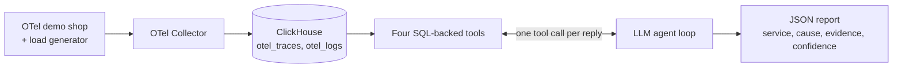

# spanhound

An AI agent that follows OpenTelemetry traces to the service that broke.

| Evaluation | Faults found | False alarms | Correct and grounded | Results |
|---|---|---|---|---|
| Live fault injection (24 runs) | **18/18** | **0/6** | 22/24 | [live_eval_20261112T192128Z.md](results/live_eval_20261112T192128Z.md) |
| Offline replay (27 runs) | **21/21** | **0/6** | 26/27 | [eval_20261110T210725Z.md](results/eval_20261110T210725Z.md) |

Both evaluations use gpt-oss-120b on Together at temperature 0. They test the agent on the [OpenTelemetry demo shop](https://github.com/open-telemetry/opentelemetry-demo) (about 15 microservices) with its built-in failure flags.

## How it works



1. **Input:** an alert ("Customers report that checkout fails") and a UTC time window.
2. **Investigation:** the agent calls the tools, reads their plain-text summaries, and picks a culprit from the shop's 14 services, or `none`.
3. **Checks on the report:**
   - every evidence quote in the report must appear in a real tool output, or the run counts as not grounded;
   - the service name is normalised to the known list.

| Tool | Answers | How |
|---|---|---|
| `error_origins` | Where did the errors start? | The deepest error spans. A Client span whose callee answered is dropped; a Client span that got no answer points at the callee. |
| `slow_operations` | What is slow? | Ranks operations by p95 **self** time (own duration minus child spans) and marks `[SLOW]` at 1,000 ms or more. |
| `error_logs` | What did services log? | Warning and error log patterns (SeverityNumber ≥ 13: warnings and errors), each with an example trace id. |
| `get_trace` | What happened in one request? | A span tree trimmed to the paths that lead to errors. |

Every tool is one parameterised SQL file in [queries/](queries/), run as a read-only ClickHouse user.

## An example investigation

This is live eval run `paymentUnreachable` #1. The `paymentUnreachable` flag makes checkout call a payment address that doesn't exist.

- **Alert:** "Customers report that checkout fails"
- **Window:** 2026-11-12 20:47:48–20:50:48 UTC
- **Tool calls:** one, to `error_origins`, which returned:

```
Error origins 2026-11-12 20:47:48 to 2026-11-12 20:50:48 UTC, most frequent first:
- checkout / oteldemo.PaymentService/Charge (Client) x7: name resolver error: produced zero addresses [client call that got no response: suspect the service it called]
```

The report, from [the results CSV](results/live_eval_20261112T192128Z.csv):

| suspected_service | cause | confidence | grounded | tokens | seconds |
|---|---|---|---|---|---|
| `payment` | Checkout fails because the checkout service's client call to the payment service encounters a name resolver error, indicating the payment service is unreachable. | 0.95 | yes | 3,477 | 112.9 |

**No payment span was involved in the failure.** In that window, payment's only span was its background flagd connection, which the tools ignore. Payment's next `Charge` server span appeared at 20:50:50, two seconds after the flag was switched off. The deepest error span is checkout's. A naive "deepest error wins" rule would blame checkout.

**The Client-span rule changes the answer:**
- If a Client error span has no child span, the callee never answered.
- `error_origins` keeps such spans and tags them with "client call that got no response".
- The prompt tells the model to blame the service named in the span, here `PaymentService`.
- If the callee had answered with an error, the Client span would be dropped and the callee's own span would be the origin.

(The CSV stores the verdict, not the evidence quotes. I reproduced the tool output above by rerunning `error_origins` on the stored traces for that window.)

## What I learned building it

The full list is in [DECISIONS.md](DECISIONS.md).

1. **The model invented evidence.** gpt-oss-120b wrote imaginary tool calls *and their results* in a single reply, and once diagnosed an `inventory-service` that doesn't exist. Together ignores `parallel_tool_calls=False`, so the fixes went into the agent:
   - it runs only the first tool call per reply;
   - every evidence quote is checked against real tool output;
   - service names are normalised to a known list.
2. **HTTP 4xx breaks the error chain.** A 4xx marks only the client span as an error, so "deepest error span" lands on the caller at every HTTP hop. `error_origins` therefore drops Client error spans whose callee responded.
3. **Timeouts are symptoms.** frontend-proxy spans with no error message, and "deadline exceeded" or "context canceled" errors, point at whoever gave up, not at the cause. They send the agent to the latency tool.
4. **Self time, not total time.** By total time, every caller up the chain looks as slow as the service it waits on. Ranking by p95 self time puts the slow service first.
5. **Don't let the model judge "slow".** In an earlier offline run, given identical evidence, the model answered `none` once and blamed checkout (about 370 ms) another time. That run had 1/6 false alarms (checkout) and 1 provider error (a timeout); its summary counted both as false alarms. With a fixed 1,000 ms threshold in the tool and a longer request timeout, both went to 0. Baselines here stay under 400 ms; incidents reach 10 s and above.
6. **Logs blame the caller.** In productCatalogFailure, only the caller (frontend) logged an error; paymentFailure produced no error log at all. Logs are therefore supporting evidence, and their trace ids point back to the traces.
7. **The load generator is noise.** It is the traffic source, not part of the system. Its own failing calls to a service that is absent in minimal mode produced false origins and `[SLOW]` lines until the tools excluded it.
8. **Faults outlive their flags.** After cartFailure is switched off, cart stays slow (about 2.5 s `GetCart`) and keeps losing redis for several minutes. Control runs that followed weren't real controls until the live eval gained a health gate.

## Evaluation

| Metric | Offline replay | Live fault injection |
|---|---|---|
| Fault accuracy, all fault runs | 21/21 (100%) | 18/18 (100%) |
| Fault accuracy, excluding provider errors | 21/21 (100%) | 18/18 (100%) |
| Fault accuracy, fault observed | n/a | 18/18 (100%) |
| False-alarm rate (baseline blamed a service) | 0/6 (0%) | 0/6 (0%) |
| Correct and grounded | 26/27 (96%) | 22/24 (92%) |
| Mean seconds | 42.0 | 60.6 |
| p95 seconds | 87.4 | 148.7 |
| Mean tokens per run | 4,792 | 4,432 |
| Mean tool calls | 1.7 | 1.5 |
| Provider errors | 0/27 (0%) | 0/24 (0%) |
| Estimated cost per run | not set (see [Cost](#cost)) | not set |

**Grounding is an exact-substring check.** Two live runs (cartFailure runs 2 and 3) named cart correctly but count as not grounded. The tool output cuts error text at 160 characters. Both runs quoted that cut-off line and then added a closing `")` that isn't in the output. The check requires each quote to be an exact substring of a real tool output, so it rejects both. I keep it strict on purpose: a quote that adds text the tool never returned is the same failure as an invented result, only smaller. The quoted line also counted x2 `EmptyCart` failures, but the same query run later returns x8 and x9 for those windows: a failing `EmptyCart` call takes about 2 minutes, and the eval investigates 90 seconds after the window ends. So the agent named cart correctly from partial data, as a real investigation during an incident would have to.

### Offline replay ([eval/run_eval.py](eval/run_eval.py))

**The incidents.** I recorded 9 incident windows from the shop and saved them as ClickHouse Native fixtures in [fixtures/](fixtures/):
- six flag faults;
- one unplanned product-catalog starvation;
- two quiet baselines.

**How a run works.** The eval loads the fixtures into a separate `otel_test` database and replays each incident 3 times. All 27/27 answers were correct: 21/21 faults and 6/6 baselines. The expected answers are in [ground_truth.md](ground_truth.md) and [eval/incidents.csv](eval/incidents.csv).

### Live fault injection ([eval/live_eval.py](eval/live_eval.py))

**The schedule.** 24 runs against the running shop: each of the six flags 3 times, plus 6 control runs with no flag.

**Each run:**
1. **Fault injection:** a flag is switched on by editing flagd's JSON file, which flagd hot-reloads.
2. **Duration:** the flag stays on for 3 minutes (4 for cartFailure) while 5 load-generator users shop. intlShippingSlowdown also gets 3 extra orders to Canada, because it only slows international orders.
3. **Switch-off:** the flag is switched off.
4. **Export wait:** the eval waits 90 s for spans to be exported.
5. **Investigation:** the agent investigates the flag-on window.

**Three safeguards:**

| Safeguard | What it does | Result |
|---|---|---|
| Seeded order | Runs are shuffled with seed 42, so faults and controls are interleaved and the sequence is reproducible. | — |
| Fault-presence check | An independent SQL query, run as admin and separate from the agent's tools, confirms the fault actually reached the telemetry. Example: error spans in payment, or shipping spans over 5 s. Accuracy is also reported on "fault observed" runs only. | Fault seen in 18/18 runs |
| Health gate | Before each run, the agent's own tools check the last 2 minutes. On any error origin or `[SLOW]` line, the eval waits 60 s and checks again, for up to 10 minutes. Runs that never settle are still run but listed separately. | Every run started on a quiet system; longest wait 3 s |

## Limitations

- **Small sample.** 24 live runs (3 per fault type) can't show a failure rate of a few percent.
- **Held out in data, not in fault type.** I knew the six fault types while writing the tool rules and the prompt. The live eval uses new traffic and new windows, but no new kinds of failure.
- **The 1,000 ms threshold fits this shop.** A real system would compare each operation to its own history.
- **One model, one provider.** All results are gpt-oss-120b on Together. Several fixes (first call only, harmony-error retries) work around that provider's behaviour.
- **Evidence can still be arriving.** Slow failing calls are exported only when they end, so when the agent runs, some of the window's spans may not be in ClickHouse yet.
- **A demo shop, not production.** Clean telemetry, about 15 services, one fault at a time, and failures that come from flags.

## Run it yourself

There are two paths. The **offline path** (tests, one saved incident, offline eval) needs only ClickHouse, started with `infra/start_clickhouse.sh`. The **live path** (live data and the live eval) also needs the OpenTelemetry demo. Steps 1–4 are the offline path and never start the demo.

**Prerequisites:** Docker, [uv](https://docs.astral.sh/uv/), Python 3.12+ and a [Together](https://www.together.ai/) API key. The live path also needs a checkout of the OpenTelemetry demo at `~/opentelemetry-demo`.

```bash
echo "TOGETHER_API_KEY=..." > .env
uv sync
```

### Offline path

**1. Start ClickHouse.** The script creates the read-only user `spanhound_ro`, and creates the demo's Docker network `opentelemetry-demo` if it doesn't exist yet, so the demo isn't needed.

```bash
infra/start_clickhouse.sh
```

**2. Run the tests.** The database tests load the fixtures into `otel_test` and are skipped if ClickHouse isn't reachable.

```bash
uv run pytest -q
```

**3. Investigate one saved incident.** This loads the paymentFailure fixtures into `otel_test` and points the agent at that database.

```bash
uv run python scripts/load_fixture.py paymentFailure
SPANHOUND_CH_DATABASE=otel_test uv run python scripts/investigate.py \
  --alert "Customers report that checkout fails" \
  --start "2026-11-10 15:52:00" --end "2026-11-10 15:54:00"
```

The expected answer is `payment`. The agent connects as `spanhound_ro`, which can read `otel_test` through the grant in [infra/clickhouse/spanhound_ro.xml](infra/clickhouse/spanhound_ro.xml).

**4. Run the offline eval.** It replays every saved incident from `fixtures/`.

```bash
uv run python eval/run_eval.py --runs 3
```

### Live path

**5. Start the demo with the ClickHouse exporter.** Copy the two extras files into the demo. ClickHouse from step 1 can keep running; the demo joins the same network.

```bash
cp infra/compose.extras.yaml ~/opentelemetry-demo/compose.extras.yaml
cp infra/otelcol-config-extras.yml ~/opentelemetry-demo/src/otel-collector/otelcol-config-extras.yml
cd ~/opentelemetry-demo && make start-minimal
```

**6. Run the live eval.** It edits the demo's flag file and takes about 3 hours; `--dry-run` prints the schedule only.

```bash
uv run python eval/live_eval.py --check-checkout-flag      # checks that flag injection works
uv run python eval/live_eval.py --dry-run
uv run python eval/live_eval.py                            # live fault injection
```

**Settings** are environment variables:

| Variable | Sets | Default |
|---|---|---|
| `SPANHOUND_MODEL` | Model | `openai/gpt-oss-120b` |
| `SPANHOUND_TEMPERATURE` | Temperature | `0` |
| `SPANHOUND_CH_HOST` | ClickHouse host | `localhost` |
| `SPANHOUND_CH_PORT` | ClickHouse port | `8123` |
| `SPANHOUND_CH_USER` | ClickHouse user | `spanhound_ro` |
| `SPANHOUND_CH_PASSWORD` | ClickHouse password | the dev password in `infra/clickhouse/spanhound_ro.xml` |
| `SPANHOUND_CH_DATABASE` | ClickHouse database | `otel` |
| `SPANHOUND_PRICE_IN` | USD per million input tokens | not set |
| `SPANHOUND_PRICE_OUT` | USD per million output tokens | not set |

## Repository layout

```
src/spanhound/
  agent.py        agent loop, prompt, grounding check, provider retries
  tools.py        the four tools: run SQL, format results for the model
  db.py           read-only ClickHouse client, window validation
  fixtures.py     load saved incidents into otel_test
queries/          one SQL file per tool (+ error_rate.sql, for analysis only)
eval/
  run_eval.py     offline replay of saved incidents
  live_eval.py    live fault injection with flagd
  incidents.csv   incident windows, alerts, expected services
fixtures/         saved incidents (ClickHouse Native, gzip)
results/          eval results: CSV per run, Markdown summary
infra/            ClickHouse start script, read-only user, demo extras
scripts/          investigate CLI, fixture loader, query runner, tool-call smoke test
tests/            pytest: tools on fixtures, agent with a fake model, eval logic
DECISIONS.md      design decisions and why
ground_truth.md   what each failure flag breaks
```

## Cost

Token use per investigation:

| | Prompt tokens | Completion tokens | Total (mean) | Total (range) |
|---|---|---|---|---|
| Live (24 runs) | 2,527 | 1,905 | 4,432 | 2,342–6,172 |
| Offline (27 runs) | 2,757 | 2,034 | 4,792 | 3,017–7,717 |

Cost per run is prompt tokens × input price + completion tokens × output price. It depends on the provider's current price for the model. To have the evals report it, set `SPANHOUND_PRICE_IN` and `SPANHOUND_PRICE_OUT` (USD per million tokens).
